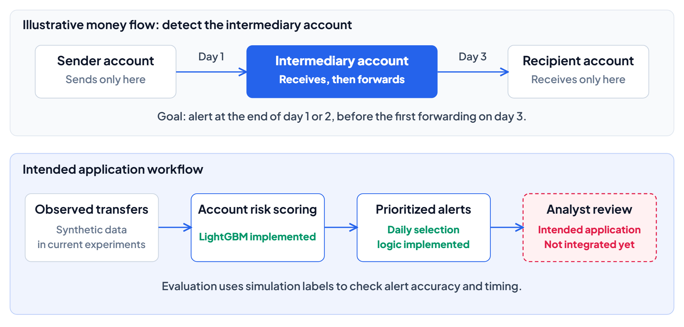
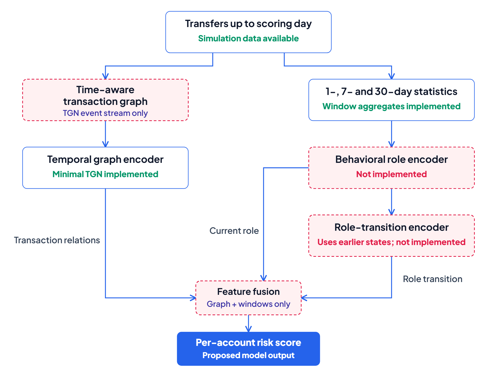

# EarlyMule-TG: problem, practical objective and proposed architecture

Updated 10 November 2026. This overview follows the advisor's research plan, the implemented evaluation protocol and the code at `c62fa61`.

The diagrams distinguish implemented components from proposed research components. The money-flow example is illustrative, not a reconstruction of a real incident.

## 1. What should the thesis achieve?

At the end of each day, use transfers observed so far to rank **accounts that may receive and forward illicit funds**, so they can be reviewed before the money moves onward or the account's illicit activity finishes.

The intended application output is a prioritized account list, risk scores and relevant transaction history for an analyst. The current experiments measure detection accuracy and timing on synthetic data. They do not measure actual fund blocking or avoided losses; operational review and response would require a separate workflow.

<!-- alt: The account in the middle is the detection target. The current experiment implements scoring and alert selection, while operational analyst integration remains future work. | source: assets/problem_overview.svg -->

*Figure 1. The detection objective and the intended application workflow. [Editable SVG](assets/problem_overview.svg).*

The thesis defines a mule as an account with both an illicit receipt and an illicit outflow in the same case, following the advisor's decision of 2 November. Source-only and recipient-only accounts are outside that positive label. **A negative label for this task is not a finding that an account holder is innocent**; it only means the account does not satisfy the thesis's intermediary definition.

## 2. Why use transaction relationships and time?

A single incoming payment may resemble a legitimate transaction. Its context can show whether the account suddenly receives from new counterparties, collects from several accounts, forwards funds along a chain or distributes funds to several recipients.

The thesis must test whether:

1. Transaction relationships add value beyond account-level statistics.
2. Their timing and evolution add value beyond a static transaction graph.
3. Changes between receiving, collecting, relaying and distributing help detect mules earlier than a generic temporal graph model.

These are hypotheses, not established results. The public cases reviewed for the project motivate these questions and expose simulation limits; they do not validate model performance in real banking.

## 3. First evaluation question: when should an account be detected?

The presentation combined three independent decisions: **the early-detection target**, **the daily review budget** and **repeat-alert suppression**.

### 3.1. Before first forwarding versus before completion

Consider this hypothetical account timeline:

| Day | Event | Meaning of an alert |
|---|---|---|
| 1 | First illicit receipt | An end-of-day alert can precede the first forwarding |
| 2 | No illicit outflow yet | An end-of-day alert can still precede the first forwarding |
| 3 | First illicit outflow | An end-of-day alert is too late for the before-first-forwarding target |
| 5 | Last illicit transaction | An alert on day 4 can precede completion, although some money has already moved onward |

**Before first forwarding** is a stricter objective than **before completion**. The former concerns an opportunity to review before the account begins forwarding illicit funds. The latter may leave only part of the activity to address. Neither metric alone establishes that a real loss was prevented.

The original research plan defines early detection relative to completion. The implemented protocol proposes detection before the first illicit outflow as the headline result, while retaining detection before completion and by completion. This is the only evaluation choice that departs from the plan's definition, so it was sent to the advisor for confirmation on 9 November.

**Day-resolution limit.** When receipt and forwarding happen on the same day, end-of-day scoring has no observation point between them. Such accounts are excluded from the denominator of the before-first-forwarding metric, but remain in the other applicable metrics. The current mean result of about 76.1% is conditional on 173 test mules with a suitable day gap; it is not 76.1% of all mules or all real-world cases. It was unchanged when the runs were repeated after early stopping was restricted to validation PR-AUC.

Under the current protocol, a credited detection must be on or after the account's illicit onset. Alerts before onset are tracked separately, not counted as successes in the headline detection metric.

### 3.2. Why review ten accounts per day?

Ten is an **assumed analyst review capacity**, not part of the mule definition or an operational optimum established by a bank.

Every eligible account is scored. The alert policy selects up to ten highest-scoring accounts that are not currently suppressed. Comparing models at the same budget makes the workload comparable: the question is which model finds more mules early with the same number of reviews.

Larger budgets may detect more mules but require more review effort. The experiment also reports budgets of 5, 20 and 50 accounts per day. Results must be interpreted under the budget that produced them.

### 3.3. Why wait thirty days before alerting the same account again?

The policy prevents repeatedly alerted accounts from using the entire daily list. Their scores may still be computed, but they temporarily cannot take another alert slot.

An account alerted on day 1 is skipped on days 2 through 30 and can be alerted again from day 31. This is an alert-list rule, not a thirty-day account freeze or evidence that the risk has disappeared.

Thirty days matches the longest current feature window. It remains an experimental operating assumption. A premature or insufficiently handled first alert can suppress a later alert during actual illicit activity, so the rule can also cause missed detections. A deployed system could require a different response policy.

## 4. Second evaluation question: which accounts should be evaluated?

This question also combines two independent choices: **the activity-history threshold** and **the treatment of other roles in the same case**.

### 4.1. Why require at least twenty transfers?

The simulator draws case members from active accounts, while many other accounts barely transact. A model could therefore learn an activity shortcut: frequently used accounts look suspicious simply because of how the dataset was assembled.

Evaluating primarily among accounts with at least twenty transfers reduces this difference. It asks a harder question: **among accounts that already transact, can the model distinguish intermediary behavior?**

| History available at the scoring day | In the current main population? |
|---|---|
| 19 transfers so far | No |
| 20 transfers so far | Yes |
| Reaches 20 transfers only next week | Not today; next week's information cannot determine today's eligibility |

The count includes incoming and outgoing transfers of any observed kind. A bank does not have illicit labels available to count only legitimate transfers. It is a cumulative count up to the scoring day, not a count restricted to the last thirty days.

**Tradeoff.** New or low-history accounts that are genuinely used as mules may be outside the main population. Population coverage and all-account results must therefore accompany the main view. With the same budget of ten alerts per day, LightGBM catches about 63% of mules before forwarding over all accounts, against 76% among regular accounts: low-history accounts take alert slots.

Twenty is not a validated banking standard. Other thresholds can be studied through a suitable validation/sensitivity procedure, without choosing a threshold to improve the already observed final-test score.

### 4.2. Why retain accounts that only receive or only send within the case?

Consider a known illicit flow in the simulation:

| Role | Thesis label |
|---|---|
| A source account only sends illicit funds | Not a mule |
| An intermediary receives and forwards illicit funds in the same case | Mule |
| An exit account only receives illicit funds | Not a mule |

An alert on the source or exit is a **false alert for the narrow mule-account target**, even though it might be useful to a broader investigation. These objectives should not be combined into one metric.

Keeping those accounts in the ranked population tests whether the model finds the intermediary role or merely any account associated with an illicit case. Their counterparties and activity can resemble those of mules, making them difficult negatives.

Removing them before ranking makes the task easier and uses case knowledge that would be unavailable when scoring live accounts. The main evaluation retains them; results without them are an additional comparison. In each view, the applicable activity-eligibility rule still applies.

This follows from the agreed mule definition, so it does not reopen that definition.

## 5. Separate the questions before discussing them

| Decision | Concrete question | Current choice and qualification |
|---|---|---|
| Detection timing | Should before-first-forwarding detection be primary, with before-completion detection still reported? | Yes, sent to the advisor on 9 November; state day resolution and the eligible denominator |
| Review capacity | Should comparisons assume an analyst reviews up to ten eligible alerts daily? | Use ten as the headline budget and report 5, 20 and 50 as well |
| Repeated alerts | Should an alerted account be excluded from the alert list for the next 29 days? | Current policy allows another alert once thirty days have elapsed; disclose missed-alert tradeoffs |
| Activity history | Should accounts with at least twenty transfers form the main evaluation population? | Yes, with all-account results and coverage reported alongside |
| Other case roles | Should source-only and exit-only accounts remain when testing false alerts? | Retain them in the main view; removal is a supplementary comparison |

Only detection timing changes a definition in the research plan, so it is the only one sent to the advisor. The other four follow from the plan or the agreed mule definition; they are applied and reported with their reasons.

## 6. What is implemented today?

The current executable pipeline:

1. Generates and reads synthetic transfers: sender, recipient, amount and day.
2. Builds account statistics from transfers observed so far, over 1-, 7- and 30-day windows.
3. Fits LightGBM on the past period and chooses the number of boosting rounds on the following validation period.
4. Scores the final test period daily and creates alerts under the common budget and suppression policy.
5. Compares alerts with simulation labels and illicit milestones to measure accuracy and timing.

**Current LightGBM does not use learned graph embeddings.** Counterparty counts carry network information, but they are not a graph model that learns relationships or temporal memory.

The alert list is currently an experimental output. The repository does not yet implement a live banking integration, an investigation interface or an operational response workflow.

## 7. What architecture does EarlyMule-TG propose?

<!-- alt: Window statistics are implemented. The temporal graph, learned role and role-transition modules, and their fusion are proposed components that are not implemented yet. | source: assets/proposed_architecture.svg -->

*Figure 2. The proposed research architecture and current implementation status. [Editable SVG](assets/proposed_architecture.svg).*

Both branches use transfers observed by the scoring day:

| Component | Intended representation | Status |
|---|---|---|
| Time-aware transaction graph | Who transacts with whom, amounts and the evolution of these relationships | Graph construction for a learned graph model is not implemented |
| Temporal graph encoder, planned with TGN | Account representations updated from observed transaction events | Not implemented |
| 1-, 7- and 30-day statistics | Counts, amounts, counterparties, new counterparties and changes across windows | Many aggregates implemented; the plan's complete feature list is not |
| Behavioral role encoder | A learned representation of receiving, collecting, relaying or distributing | Not implemented |
| Role-transition encoder | Differences from earlier states or between time scales | Not implemented |
| Fusion and risk scoring | Combine graph relationships, current role and role change | Not implemented |

The role encoders consume observable behavior. Simulator labels, case types and simulator-known roles must not become prediction features.

The research plan's fusion takes all three representations: graph, current role and role transition. Figure 2 preserves each input instead of reducing the behavior branch to only its final transition output.

An illustrative motivation: over thirty days an account pays a few familiar counterparties, but recently starts receiving from many new senders. Incoming-side changes could inform an alert before forwarding if the data provides that opportunity. Later outgoing evidence can strengthen a subsequent score, but cannot be used retrospectively to justify an earlier prediction.

## 8. Where do labels belong?

| Information | Use | Prediction input? |
|---|---|---|
| Sender, recipient, amount and observed transfer day | Build features and graph history up to scoring time | Yes, under the allowed-column policy |
| Mule labels in the training period | Supervise the relationship between observed history and the target | Training target, not an input feature |
| Test onset, first illicit outflow and completion | Evaluate alerts after scores have been produced | Evaluation only |
| Case type, planned layer and simulator illicit flags | Label auditing and result breakdowns | Never prediction features |

Every model must use the same chronological split and alert policy. Finished mules remain in the ranked population if still eligible; ground truth must not silently remove them before top-alert selection. Whether a row contributes to a label-based metric is a separate evaluation decision.

## 9. How will the proposed architecture be tested?

Compare LightGBM with a static graph model, a temporal graph model and the required attention-based reference model. Then compare the temporal model with role state, role transitions and the full combination added separately.

Keep data, chronological split, ranked population, alert budget and suppression policy constant. Repeat runs to expose variation and resample whole cases to obtain intervals for paired differences. Report early detections and alert precision rather than treating architectural complexity as evidence of improvement.

The plan also requires label-scarcity experiments. External data is an extension after the mandatory work is stable. A negative result remains useful if chronology is correct, leakage is excluded, and the analysis explains why an added component did not help.

## 10. Limits of the practical interpretation

- Current data is synthetic and day-resolved, not a real banking stream with intraday timestamps.
- Completion is the account's last illicit transfer, not a known cash-withdrawal time.
- Device information, API logs, cross-bank identity links and crypto-wallet paths are unavailable.
- Simulated holding-time and forwarding-ratio assumptions are not universal real-world rules.
- Low-history accounts can be outside the main view; population coverage must remain explicit.
- The proposed architecture has not yet demonstrated real-world accuracy or prevention of onward money movement.

## 11. References within the project

- [Advisor's research plan](research_plan.md): objectives, temporal graph, multi-scale roles, fusion and component comparisons.
- [Current evaluation protocol](evaluation_protocol.md): detection timing, population, budgets, suppression and metric denominators.
- [Data specification](data_spec.md): generation, labels, inputs and limits.
- [Point-in-time account features](../src/earlymule/features/point_in_time.py).
- [Daily LightGBM pipeline](../src/earlymule/models/daily_scoring.py).
- [Alert selection and detection timing](../src/earlymule/evaluation/early_detection.py).

This document explains the current system and proposed architecture. It does not change labels, data, metrics, configuration or the project schedule.
