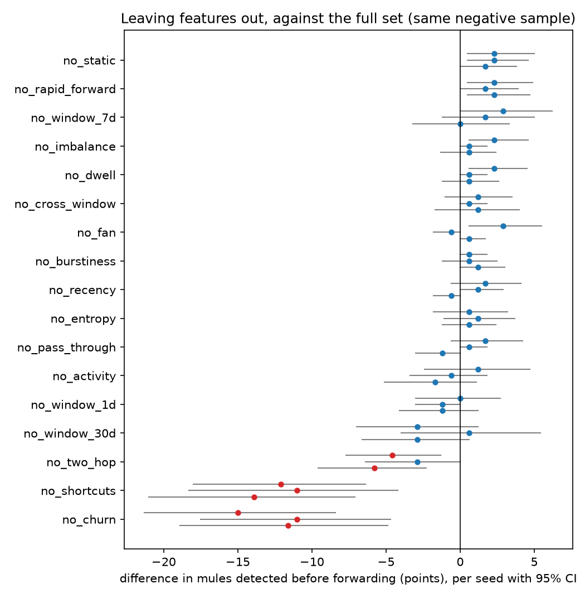
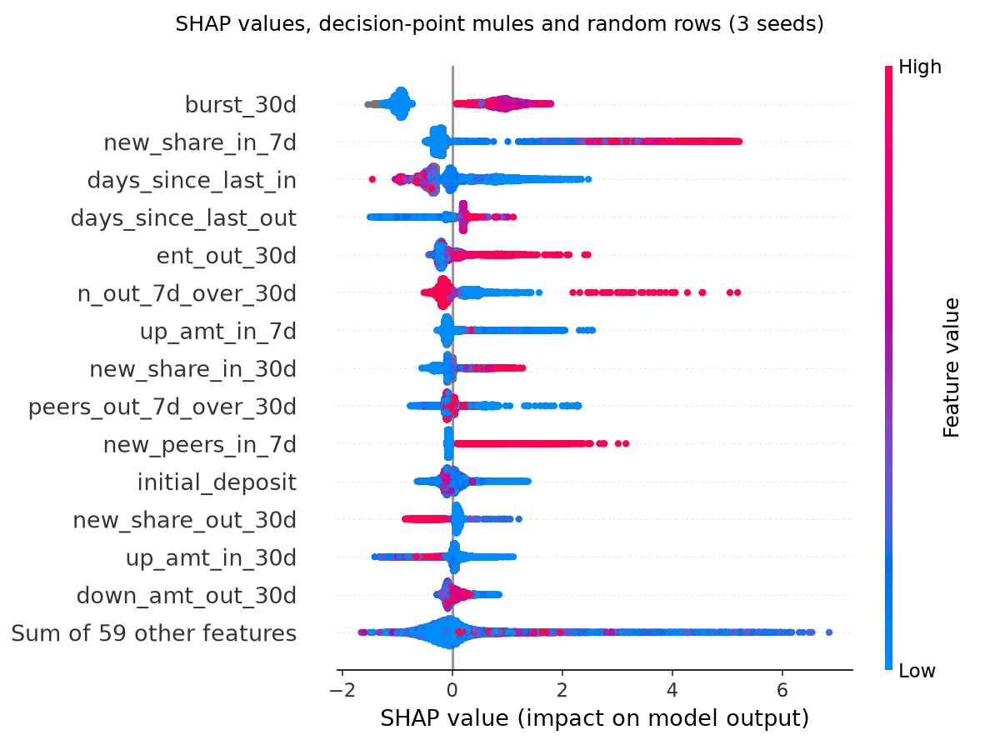

# Which features identify a mule: ablation and SHAP of the daily LightGBM

2026-11-16, EMTG-70. Answers the advisor's point of 2026-11-15 that the key is features that identify an account as a money mule. Builds on the post-run EDA (`reports/post_run_eda.md`). Tables and figures: `reports/figures/features/`.

## Setup

- **Model.** The daily LightGBM with 73 features (the 72 point-in-time features of the data spec plus `initial_deposit`), trained from the Kaggle export `beb2a5d` by `python -m earlymule.models.lightgbm_export` (commit `956b8a1`, Kaggle CPU, about 10 minutes a run). Evaluated with `import_scores` under the protocol: test, regular accounts, 10 new alerts per day, 30-day cooldown; primary metric = share of mules alerted before their first illicit outflow (173 test mules).
- **Ablation.** 18 configurations × 3 seeds = 54 runs (`configs/lightgbm_ablation.yaml`): the full set, each of the 13 feature families left out, each window (1, 7, 30 days) left out, and the three families tied to simulator regularities (counterparty churn, pass-through, rapid-forward) left out together. Within a seed every configuration uses the same 1% sample of training negatives, so the paired case-bootstrap difference against the full set of the same seed isolates the features. Summary: `python -m earlymule.analysis.ablation_summary`.
- **SHAP.** Interventional TreeSHAP of the three full-set models (background: 500 training negatives of the same seed) on three groups of test rows: mules at the end of the day before their first outflow, false alerts (top 10 per day that are not an active mule), and random rows. LightGBM's path-dependent `pred_contrib` agrees on the ranking (Spearman 0.99 per seed, 8 or 9 of the top 10 shared). `python -m earlymule.analysis.shap_values`.

**Reference run.** The full set trained this way detects 81.0% before forwarding (82.1 / 80.0 / 80.9 by seed), against 83.2% for the logged `lightgbm_daily`. The two differ only in the training negative sample: the export's features are identical (the logged model scores the export's 4.4 million test and validation rows to the same values), and the same script on LightGBM 4.7 locally reproduces the Kaggle run (4.6) exactly. The sample alone moves the primary metric by 3 to 4 points, a source of variation that the per-seed case-bootstrap interval does not cover.

## Ablation

Difference in mules detected before forwarding against the full set of the same seed, in points; 95% paired case-bootstrap interval per seed.

| Left out | Before forwarding | Mean difference | Per seed | Validation PR-AUC |
|---|---:|---:|---|---:|
| (full set) | 80.9% | | | 0.593 |
| counterparty churn | 68.4% | **−12.5** | −11.6 [−18.9, −4.9] · −11.0 [−17.5, −4.7] · −15.0 [−21.3, −8.4] | 0.540 |
| churn + pass-through + rapid-forward | 68.6% | **−12.3** | −13.9 [−21.0, −7.1] · −11.0 [−18.3, −4.2] · −12.1 [−18.0, −6.4] | 0.547 |
| two-hop flow | 76.5% | −4.4 | −5.8 [−9.6, −2.3] · −2.9 [−6.4, 0.0] · −4.6 [−7.7, −1.3] | 0.551 |
| 30-day window | 79.2% | −1.7 | −2.9 · +0.6 · −2.9 (all intervals cross 0) | 0.532 |
| 1-day window | 80.2% | −0.8 | intervals cross 0 | 0.587 |
| activity | 80.5% | −0.4 | intervals cross 0 | 0.568 |
| pass-through, entropy, recency, burstiness, fan, across windows, dwell, imbalance | 81.3% to 82.1% | +0.4 to +1.2 | intervals cross 0 or touch it | 0.577 to 0.598 |
| 7-day window | 82.5% | +1.5 | intervals cross 0 | 0.525 |
| rapid-forward | 83.0% | +2.1 | +2.3 [+0.5, +4.7] · +1.7 [0.0, +3.9] · +2.3 [+0.5, +4.9] | 0.601 |
| static (`initial_deposit`) | 83.0% | +2.1 | +1.7 [0.0, +3.8] · +2.3 [+0.5, +4.6] · +2.3 [+0.5, +5.0] | 0.590 |

1. **Counterparty churn is the only family the model cannot do without.** Leaving it out costs 12.5 points in every seed; leaving out pass-through and rapid-forward as well adds nothing more (−12.3), so those two carry no signal of their own on top of it.
2. **Two-hop flow is the second contributor** (−4.4 points; interval below 0 in two seeds and touching 0 in the third): the volume that a mule's new senders themselves received, i.e. the case's money arriving from upstream.
3. **Every other family is replaceable.** Leaving one out moves the result by less than 2 points with intervals across 0, because the information is duplicated elsewhere (48 correlation clusters among 73 features, EDA finding 6).
4. **Rapid-forward and the opening balance slightly hurt** (+2.1 points when left out, intervals at or above 0 in all seeds); for rapid-forward the validation PR-AUC also rises (0.593 to 0.601). At the decision point a mule has not forwarded yet, so these features add noise. Any change of the feature set has to be chosen on validation, not on these test numbers.
5. **Windows.** The 30-day window matters for cycles (below); the 7-day window lowers validation PR-AUC most (0.593 to 0.525) yet not test detection, a reminder that the two metrics can disagree.

**By typology** (change in points, mean of 3 seeds; `ablation_by_typology.csv`):

| Left out | Cycle | Relay chain | Collect, disperse | Fan in, fan out | Collect, exit |
|---|---:|---:|---:|---:|---:|
| counterparty churn | −27.8 | −21.2 | −15.9 | −7.3 | +2.4 |
| churn + pass-through + rapid-forward | −29.2 | −21.2 | −14.3 | −8.3 | +3.2 |
| two-hop flow | −9.7 | −9.1 | −5.6 | −2.1 | +1.6 |
| 30-day window | −23.6 | +1.0 | −0.8 | +4.2 | +3.2 |

Cycles and relay chains, the typologies with the shortest time to the first outflow, depend most on the new-sender signal; collect-and-exit mules (median 4 days before they forward, several inflows) are found without it.

## SHAP

Mean |SHAP| per family (the SHAP values of a family's columns summed per row), log-odds, 3 seeds:

| Family | Mules at the decision point | False alerts | Random rows |
|---|---:|---:|---:|
| counterparty churn | 6.25 | 5.05 | 0.58 |
| recency | 1.45 | 1.21 | 0.50 |
| burstiness | 1.24 | 1.15 | 0.92 |
| across windows | 0.98 | 1.48 | 0.39 |
| two-hop flow | 0.80 | 0.62 | 0.25 |
| activity | 0.71 | 0.54 | 0.23 |
| rapid-forward | 0.16 | 0.15 | 0.08 |
| dwell time | 0.06 | 0.05 | 0.04 |

1. **The score of a mule is mostly counterparty churn:** a share of new senders near 1 in the last 7 days adds up to about 5 to the log-odds.
2. **False alerts are scored the same way** (5.05 from churn). Sources and exits of a case also deal with new partners during the case, which is why about 30% of alerts land on case members that are not mules (EDA finding 9).
3. **`burst_30d` ranks first on random rows** and is large for mules, but leaving burstiness out changes nothing (+0.8 points). About half of all regular accounts sit exactly at −1, a perfectly regular schedule of the simulator's normal models; the model reads "regular, then new senders" and the same information is available from other families. A large SHAP value does not make a family necessary.
4. **Rapid-forward and dwell time contribute almost nothing** before the first outflow, in line with the EDA and with finding 4 of the ablation.

## Conclusions

- **Which features identify a mule (the advisor's question).** In this dataset and at the moment that matters, before the first outgoing illicit transfer, one signal does the work: money arriving from senders the account has never dealt with, against its own recent history (counterparty churn), helped by how much those senders themselves just received (two-hop flow). The features built around forwarding (pass-through, rapid-forward, dwell time) only become informative after the first outflow.
- **How much of it is the simulator.** The decisive family is the one most tied to a simulator regularity: regular accounts pay fixed partners on fixed schedules, so only 17.4% of them meet a new partner in a week, against 97.6% of mules (EDA finding 7). On real data, where customers pay new people often, this signal will be weaker. The thesis has to state that the result rests on it, and the transfer-level scoring (EMTG-72) should be reported with and without churn features.
- **What it means for the models.** The neural models get the same features; a model can beat LightGBM only through information the families above do not hold. The graph signal that helped here is two-hop flow, which the temporal graph models can learn from the event stream rather than from a hand-made feature.
- **Methodological note.** The training negative sample alone moves LightGBM by 3 to 4 points on the primary metric. Comparisons in the protocol that use a separate model per seed include this variation; paired comparisons on the same sample, as here, do not.

## Files

| File | Content |
|---|---|
| `figures/features/ablation_summary.csv` | All 18 configurations: PR-AUC, detection before forwarding, differences per seed with intervals |
| `figures/features/ablation_by_typology.csv` | Change per typology |
| `figures/features/shap_mean_abs_by_feature.csv` | Mean \|SHAP\| per feature and row group |
| `figures/features/shap_family_by_group.csv`, `shap_family_by_typology.csv` | Mean \|SHAP\| per family |
| `figures/features/shap_vs_pred_contrib.csv` | Agreement of interventional SHAP and `pred_contrib` |
| `figures/features/*.png` | Figures above and SHAP by family |
