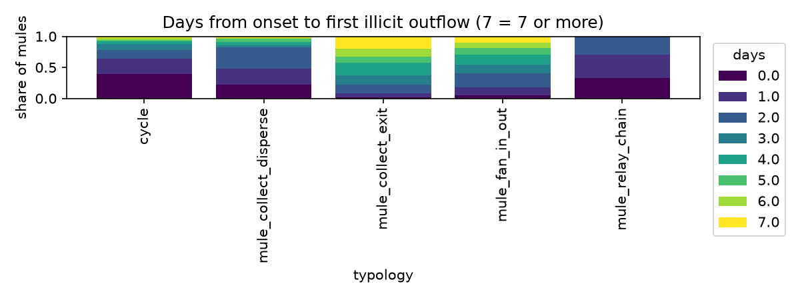
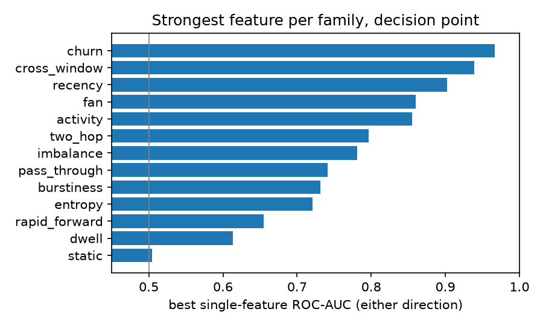
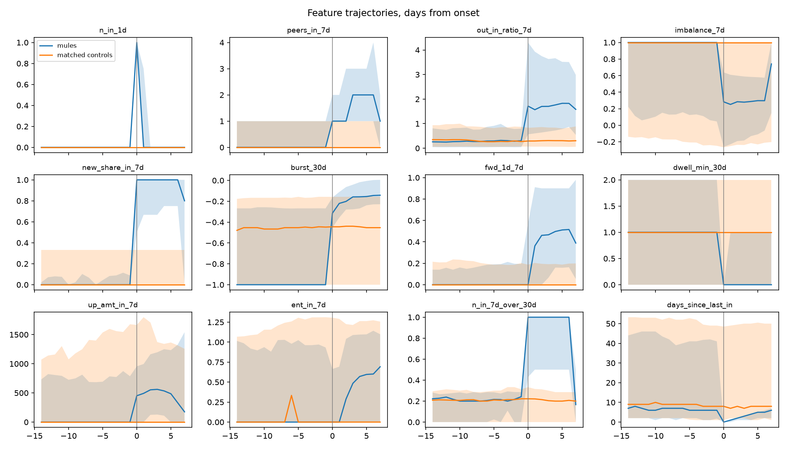

# Post-run EDA of `80K-earlymule-mule`

2026-11-15, EMTG-69. Notebook: `notebooks/02_post_run_eda.ipynb` (about 5 minutes in WSL); helpers: `src/earlymule/analysis/eda.py`; tables and figures: `reports/figures/eda/`. The earlier EDA (`notebooks/01_amlsim_eda.ipynb`) checked feasibility on the old 10K run before AMLSim was modified; this one covers the dataset the models are trained on, the 72 point-in-time features plus `initial_deposit`, and the test outcomes of two trained models.

**Explained version (2026-11-16).** `notebooks/03_eda_explained.ipynb` repeats this analysis in 13 short parts with simple helpers (`src/earlymule/analysis/eda_explained.py`), random scored accounts on the same day as the only reference group, a feature dictionary, one example mule per typology, a comparison with non-mule case members and a leakage check; slide-ready charts are in `figures/eda_explained/` (numbered by part). Its numbers match those below; it adds findings 10 and 11.

**Decision point.** End-of-day scoring can stop a mule only on a day before its first illicit outflow, so the features are compared at the end of day (first outflow − 1): 620 mules that leave at least one day and are in the scored population by then, against 11,760 regular accounts outside every case (30 per day, same days). The single-feature ROC-AUC is reported in either direction (below 0.5 = lower in mules).

## Findings

1. **Dataset.** 96,344 accounts, 31,560 with at least one transfer, 15,416 in the scored population (20 or more transfers) by the last day; 1,789,235 transfers, 3,059 illicit. 942 mules in 440 mule cases; 2,589 case members are not mules (1,467 sources, 1,050 destinations, 30 one-sided collectors, 30 one-sided dispersers, 12 without an illicit transfer).

2. **A bank has little time.** From onset to the first illicit outflow: median 2 days; 23.6% of mules forward on the day they start and 22.5% one day later. In execution order, 182 of the 222 same-day mules receive before they forward and 40 (the cycle initiators) forward first.

   | Typology | Mules | Median days to first outflow | Same day | Median case days |
   |---|---:|---:|---:|---:|
   | cycle | 321 | 1 | 39.3% | 1 |
   | relay chain | 151 | 1 | 33.1% | 1 |
   | collect, disperse | 170 | 2 | 21.8% | 2 |
   | fan in, fan out | 150 | 3 | 4.7% | 5 |
   | collect, exit | 150 | 4 | 1.3% | 4 |

   

3. **Before onset, mules look like everyone else.** Three days before onset, no feature separates 804 mules from 8,180 random regular accounts (best single-feature ROC-AUC 0.515). The simulator gives mules no prior profile, so every signal the models use appears at or after onset.

4. **At the decision point the signal is incoming, not outgoing.** The strongest single features describe new money arriving from new senders:

   | Feature | Family | Mules (median) | Others (median) | ROC-AUC |
   |---|---|---:|---:|---:|
   | `new_share_in_7d` | counterparty churn | 1.00 | 0.00 | 0.967 |
   | `new_peers_in_7d` | counterparty churn | 1 | 0 | 0.940 |
   | `n_in_7d_over_30d` | across windows | 1.00 | 0.21 | 0.939 |
   | `new_share_in_30d` | counterparty churn | 1.00 | 0.00 | 0.930 |
   | `days_since_last_in` | recency | 0 | 7 | 0.097 (0.903 inverted) |
   | `peers_in_7d` | fan-in | 2 | 0 | 0.860 |

   The families built to describe forwarding are weak here: rapid-forward 0.655, dwell time 0.613 at best, because the mule has not forwarded yet. They only move after the first outflow (trajectory figures). The same top feature, `new_share_in_7d`, leads for every typology (ROC-AUC 0.94 to 0.98).

   

5. **Trajectories.** Aligned on onset, the incoming features jump on day 0 (`new_share_in_7d` and `n_in_7d_over_30d` to 1, `days_since_last_in` to 0); pass-through, rapid-forward and imbalance move with the first outflow. Matched controls share only the activity decile, so differences before onset in the figure (for example `burst_30d`, where half of all regular accounts sit at −1) are matching noise; finding 3 is the controlled check.

   

6. **Redundancy.** At |Spearman ρ| > 0.9 the 73 features form 48 clusters. The largest: the 1-day pass-through cluster (`imbalance_1d`, `out_in_ratio_1d`, `fwd_0d_1d`, amounts; 5 features) and the 7-day incoming-volume cluster (`peers_in_7d`, `n_in_7d`, `amt_in_7d`, `ent_in_7d`). Leaving out one family can therefore be masked by another, which is why the ablation also leaves out the three shortcut families together (EMTG-70).

7. **Simulator shortcuts, measured.** Layered mules forward 90% of what they receive (99.7% of them between 0.89 and 0.91); illicit amounts have a median of 155.5 against 549.8 for normal ones; the first illicit outflow is 0.3% of the balance before it (balances were raised when AMLSim was modified, so mules never drain the account); 97.6% of mules met a new partner in the 7 days before the decision point against 17.4% of regular accounts. The strongest feature family (finding 4) is also the one most tied to the simulator's regular normal behaviour.

8. **What the models miss** (test, 10 new alerts per day, 30-day cooldown, 3 seeds each; LightGBM with the 72 features and the role-transition step, both at `7bfcfb4`; 173 test mules that leave a day before forwarding):
   - Cycles are the hardest: caught before forwarding 58.3% (LightGBM) and 62.5% (role transition), against 82% to 94% for the layered typologies.
   - Busy accounts hide the signal: by activity at onset, the lowest quarter is caught 97.8% / 98.5%, the highest quarter 59.1% / 56.1%. A few new senders stand out less in an account that already receives from many.
   - 126 mules are caught by both models in all seeds; 12 are never caught by either.

9. **Where the alerts go.** About 12% of alerts land on an active mule, the ceiling at this budget (protocol section 5). Case members that are not mules take 32% of LightGBM alerts and 29% to 31% of role-transition alerts: sources and exits also receive from new partners during a case. 48% to 54% go to other accounts and 5% to 7% to mules outside their case days.

10. **Ordinary accounts are clockwork.** Over 720 days, a scored account outside every case has a median of 2 distinct partners, sends or receives half of its transfers with its top partner, and 21% of them have exactly the same gap between all their active days (explained notebook, part 3). This is the root of the counterparty-churn signal.

11. **Why sources and exits draw alerts.** On their first illicit day, case members that are not mules have a median `new_share_in_7d` of 0.67 (mules 1.00, regular accounts 0.00) and a raised `n_in_7d_over_30d` (0.43 against 0.20): they also deal with new partners during a case, so a model built on that signal scores them high (explained notebook, part 10).

## What this means for the next steps

- **The advisor's question, which features identify a mule:** under end-of-day scoring before the first outflow, the evidence is a sudden inflow from senders the account has never dealt with, measured against its own 30-day baseline. Forwarding behaviour, the classic mule signal, is not yet observable at that point.
- **Scoring before the transfer is executed (EMTG-72)** adds exactly what is missing: at the pending transfer the bank sees the outgoing side (amount against the fresh inflow, new payee, the payee's own behaviour). It also reaches the 182 same-day mules that receive first.
- **The feature ablation (EMTG-70)** has to show how much of the result rests on counterparty churn, the family most tied to the simulator's regular normal accounts; `no_churn` and `no_shortcuts` are the key rows.
- **Error analysis (EMTG-58)** starts from the two groups above: cycle mules and high-activity mules, plus the case members that take a third of the alerts.

## Files

| File | Content |
|---|---|
| `figures/eda/summary.json` | Headline numbers of the notebook run |
| `figures/eda/univariate_decision_point.csv` | All 73 features at the decision point: medians, missing shares, SMD, ROC-AUC, KS, PR-AUC |
| `figures/eda/univariate_before_onset.csv` | Same, three days before onset |
| `figures/eda/univariate_by_typology.csv` | Best three features per typology |
| `figures/eda/correlation_clusters.csv` | Clusters at \|ρ\| > 0.9 and their representative |
| `figures/eda/timeline_by_typology.csv`, `feature_lead.csv` | Timeline summary; earliest separating day against matched controls |
